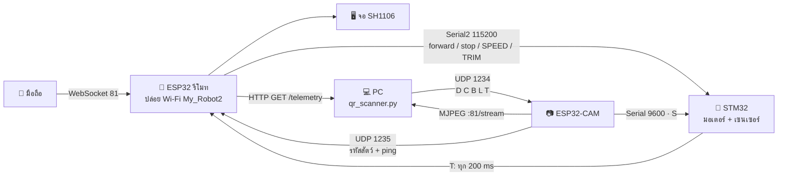

# Tiny Robot — สรุปโปรเจกต์

> เอกสารฉบับย่อสำหรับคนที่อยากเข้าใจภาพรวมทั้งระบบภายในสิบนาที
> รายละเอียดเต็มพร้อมเหตุผลเบื้องหลังทุกค่าอยู่ใน [`README.md`](../README.md)
> ส่วนสไลด์สำหรับสอนคนใช้งานใหม่อยู่ที่ [`Tiny-Robot-Setup-Guide-TH.pptx`](Tiny-Robot-Setup-Guide-TH.pptx)

---

## โปรเจกต์นี้คืออะไร

หุ่นยนต์สองล้อที่เดินตามเส้นดำได้เอง อ่าน QR ที่วางไว้ข้างทางแล้วหยุด 5 วินาที
พร้อมวาดรูปสัตว์ที่อ่านได้ขึ้นจอบนตัวหุ่น และสั่งงานด้วยมือผ่านหน้าเว็บบนมือถือได้ตลอดเวลา

ระบบประกอบด้วยบอร์ด 3 ตัวกับเครื่อง PC อีกหนึ่งเครื่อง
แบ่งหน้าที่กันชัดเจนจนแต่ละส่วนทดสอบแยกกันได้ และถ้าส่วนไหนพัง ส่วนที่เหลือยังทำงานต่อได้

| ชั้น | ต้องมีอะไร | ได้อะไร |
|:--|:--|:--|
| ชั้นที่ 1 | STM32 ตัวเดียว | เดินตามเส้นได้ครบ ทั้งเข้าโค้ง หาเส้นที่หลุด และหยุดที่เส้นชัย |
| ชั้นที่ 2 | เพิ่ม ESP32 | รีโมทผ่านมือถือ จอ OLED และช่องส่งข้อมูลออกมาเก็บ |
| ชั้นที่ 3 | เพิ่ม ESP32-CAM กับ PC | อ่าน QR แล้วสั่งหุ่นหยุด พร้อมบันทึกการวิ่งลง Excel |

---

## ภาพรวมระบบ



ทุกอย่างอยู่บน Wi-Fi ที่ ESP32 รีโมทปล่อยเอง ไม่พึ่งเราเตอร์ที่ไหน
รีโมทเป็นเกตเวย์ของวงเสมอ IP จึงเป็น `192.168.4.1` ตายตัว
ส่วนกล้องได้ IP อะไรก็ได้ตั้งแต่ `.2` ขึ้นไป สคริปต์ฝั่ง PC จึงไล่หากล้องเองทุกครั้งที่เปิด

---

## หน้าที่ของแต่ละส่วน

### STM32 Blue Pill — `stm32_robot_controller/`

สมองของหุ่น และเป็นส่วนเดียวที่แตะมอเตอร์โดยตรง

อ่านเซนเซอร์ 5 ดวง คำนวณแรงเลี้ยวแบบ PD แล้วสั่ง PWM ออก DRV8833
รับคำสั่งจากรีโมททาง `Serial2` และรับสัญญาณหยุดจากกล้องทาง `Serial3` คนละช่องกัน
ทั้งสองบอร์ดจึงสั่งงานได้พร้อมกันโดยไม่ชนกัน

### ESP32 — `esp32_remote_controller/`

ปล่อย Wi-Fi `My_Robot2` เปิดเว็บเซิร์ฟเวอร์ที่พอร์ต 80 และ WebSocket ที่ 81
วาดจอ OLED ด้วยการส่งทีละหน้าเอง ไม่ผ่าน `display()` ของไลบรารี
และเปิดช่อง `GET /telemetry` ให้ PC มาดึงค่าสถานะล่าสุดไปเก็บ

### ESP32-CAM — `esp32_camera_server/`

กล้องของหุ่น ส่งภาพสดออกไปให้ PC อ่าน QR
พอ PC ถอดรหัสได้ก็ยิง UDP กลับมา บอร์ดนี้จะส่ง `S` ไป STM32 ให้หยุด
แล้วส่งรหัสสัตว์ต่อให้รีโมทเพื่อวาดรูปขึ้นจอ

### เครื่อง PC — `pc_qr_scanner/qr_scanner.py`

ถอดรหัส QR และเก็บข้อมูลการวิ่งลงไฟล์ CSV บนเดสก์ท็อป
ไม่มีกล้องก็รันได้ ส่วนที่เก็บข้อมูลยังทำงานครบเหมือนเดิม

---

## โพรโทคอลระหว่างส่วน

| จาก → ไป | ช่องทาง | ส่งอะไร |
|:--|:--|:--|
| รีโมท → STM32 | `Serial2` 115200 | `forward` `backward` `left` `right` `stop` `MODE:AUTO` `MODE:MANUAL` `SPEED:<n>` `TRIM:<n>` |
| STM32 → รีโมท | `Serial2` 115200 | บรรทัด `T:` 16 ช่อง ทุก 200 ms |
| PC → กล้อง | UDP 1234 | `D` `C` `B` `L` `T` (DOG CAT BIRD LION TIGER) |
| กล้อง → STM32 | `Serial3` 9600 | `S` = หยุด 5 วินาที |
| กล้อง → รีโมท | UDP 1235 | รหัสสัตว์ และ `P` ทุก 2 วินาทีเพื่อบอกว่ายังอยู่ |
| รีโมท → เบราว์เซอร์ | WebSocket 81 | `CAMIP:<ip>` `ANIMAL:<name>` |
| รีโมท → PC | HTTP `GET /telemetry` | บรรทัด `T:` ล่าสุด |

---

## หัวใจของการเดินตามเส้น

ตัวควบคุมเป็น **PD ไม่ใช่ PID** เต็มรูป เพราะงานนี้ไม่มี error สะสมที่ต้องแก้

ค่า `error` มาจากตำแหน่งที่เซนเซอร์เจอเส้น อยู่ในช่วง **−4 ถึง 4**
`Kp` จึงคูณเข้าไปได้ไม่เกินช่วงที่มอเตอร์รับไหวจริง คือ 255

```text
turn = Kp × error + Kd × (error ที่เปลี่ยนไป)
```

ที่ `Kp = 45` แรงเลี้ยวสูงสุดราว 180 ซึ่งอยู่ในช่วงที่ใช้ได้
เคยลอง `Kp = 80` แล้วพุ่งถึง 320 ผลคือล้อนอกตันที่ 255 ส่วนล้อในกลับทาง
หุ่นเลยหมุนรอบตัวเองทุกโค้งแทนที่จะเอียงเข้าโค้ง

**ไม่มีการปัดค่า PWM ขึ้น** (`MIN_PWM = 0`) สั่งเท่าไหร่มอเตอร์ได้เท่านั้น
ค่าต่ำกว่าราว 135 ล้อจะไม่หมุน ซึ่งยอมรับได้ เพราะอยากให้เลขในล็อกตรงกับของจริง
ถ้าอยากให้ล้อหมุนเสมอ ตั้ง `MIN_PWM = 135` แต่ค่า 1 ถึง 134 จะกลายเป็นค่าเดียวกันหมด

---

## หุ่นรู้ได้ยังไงว่าถึงเส้นชัย หรือหลุดเส้นไปแล้ว

สองอย่างนี้คือ **คนละขั้วของกันและกัน** และเคยสับสนกันจนหุ่นหยุดกลางสนามมาแล้ว

| เซนเซอร์อ่านได้ | แปลว่า | หุ่นทำอะไร |
|:--|:--|:--|
| ดำครบทั้ง 5 ดวง | ถึงเส้นชัย | เบรกแล้วออกจากโหมดออโต้ |
| ไม่เจอเส้นเลยสักดวง | เส้นอยู่นอกแถวเซนเซอร์ | ดันตัวเองไปหาจนกว่าจะเจอ |

ดำครบ 5 ดวงต้องค้างนาน `FINISH_CONFIRM_MS` = 40 ms ถึงจะนับว่าเป็นเส้นชัย
สั้นกว่านั้นคือทางแยกหรือเส้นตัด ซึ่งหุ่นจะวิ่งตรงผ่านไป

### ขั้นตอนการหาเส้นที่หลุด

1. **รอ 150 ms ก่อน** — ยังไม่ตัดสินใจอะไร เลี้ยวค้างไปทางเดิมต่อ
   ทางโค้งแคบจะเหวี่ยงเส้นออกนอกแถวเซนเซอร์ชั่วครู่เป็นเรื่องปกติ และส่วนใหญ่จบก่อนเวลานี้
2. **ถอยหลัง 400 ms** — ถอยเอียงไปทางที่เพิ่งเห็นเส้นครั้งสุดท้าย แก้กรณีเข้าโค้งเร็วเกินจนหลุด
3. **กวาดหาจนครบ 6 วินาที** — หมุนอยู่กับที่ด้วยความเร็ว 55% สลับซ้ายขวา แต่ละรอบกว้างขึ้นเรื่อยๆ

ที่กวาดช้ากว่าการเลี้ยวปกติ เพราะถ้าหมุนเร็ว เส้นจะวิ่งผ่านใต้แถวเซนเซอร์เร็วกว่าที่เซนเซอร์อ่านทัน
แล้วหุ่นจะเลยจุดที่ข้ามเส้นไปแล้วโดยไม่รู้ตัว

ทิศที่กวาดรอบแรกถูกเลือก **ครั้งเดียวตอนเริ่มหา** ไม่คำนวณใหม่ระหว่างทาง
ไม่งั้นจะกวาดไปทางเดิมซ้ำๆ แล้วเดินห่างจากเส้นออกไปเรื่อยๆ

---

## จอ OLED

จอเป็น **SH1106** ไม่ใช่ SSD1306 ทั้งที่โมดูลหน้าตาเหมือนกันเป๊ะ
SH1106 ไม่รองรับโหมด horizontal addressing ที่ไลบรารี SSD1306 ใช้
ถ้าเลือกผิด ภาพทั้งเฟรมจะไปกองอยู่หน้าแรกหน้าเดียว เห็นเป็นแถบอัดอยู่บนสุดของจอ

โค้ดส่งภาพออกจอเองทีละหน้า ครั้งละ 16 ไบต์ ไม่ใช้ `display()` ของไลบรารีที่ส่งทีเดียว 1 KB
ถ้าหน้าไหนส่งพลาด จะเสียแค่แถบเดียว ไม่ลามทั้งเฟรม

ภาพทุกหน้ายกเว้นหน้าสถานะเป็นบิตแมปเต็มจอ 128×64 ที่วาดตัวหนังสือไว้ในรูปแล้ว
ต้นฉบับอยู่ใน `assets/oled/*.png` แปลงเป็นเฮดเดอร์ด้วย `py tools/png_to_bitmaps.py`

---

## ข้อมูลที่เก็บได้

สคริปต์ฝั่ง PC เขียน CSV ลงเดสก์ท็อป หนึ่งแถวต่อวินาที บวกอีกหนึ่งแถวทุกครั้งที่อ่าน QR ได้
รวม 20 คอลัมน์ เปิดใน Excel แล้วลากไปพล็อตกราฟได้ทันที

สิ่งที่ตั้งใจออกแบบไว้ในนั้น

- **แยกเซนเซอร์เป็นคอลัมน์ละดวง** ไม่ยุบเป็น `00100` ช่องเดียว เพราะ Excel จะอ่านเป็นตัวเลขแล้วตัดศูนย์หน้าทิ้งจนเหลือ `100`
- **เก็บ `Kp` กับ `Kd` ทุกแถว** ทั้งที่เป็นค่าคงที่ เปิดไฟล์เก่ามาดูแล้วรู้ทันทีว่ารอบนั้นจูนด้วยค่าอะไร ไม่ต้องไปพึ่งความจำใคร
- **เก็บ `Action` เป็นข้อความ** เพราะตัวเลขอย่างเดียวบอกไม่ได้ว่าทำไม — `200/80` เป็นได้ทั้งหุ่นเข้าโค้งและหุ่นกำลังกวาดหาเส้น ซึ่งในตารางหน้าตาเหมือนกันทุกประการ
- **เขียนแถวเสมอแม้ติดต่อหุ่นไม่ได้** ช่องจะว่างแต่เวลายังเดิน คอลัมน์จึงตรงกันทุกแถว
- **ค่ามอเตอร์เป็นค่าหลังหัก trim แล้ว** คือค่าที่ถึงมอเตอร์จริง ไม่ใช่ค่าที่ตัวควบคุมขอ สองอย่างนี้ต่างกันบ่อย และช่องว่างระหว่างมันมักเป็นคำตอบเวลาหุ่นไม่ทำตามที่คำนวณไว้

---

## ค่าคงที่ที่ปรับบ่อย

| ชื่อค่า | ค่าปัจจุบัน | ไฟล์ |
|:--|:--:|:--|
| `Kp` / `Kd` | `45` / `35` | `stm32_robot_controller.ino` |
| `baseSpeed` | `180` (สไลเดอร์บนเว็บทับค่านี้) | เดียวกัน |
| `MIN_PWM` | `0` | เดียวกัน |
| `leftMotorOffset` | `25` (ปรับสดจากแถบ Trim ได้) | เดียวกัน |
| `LOST_CONFIRM_MS` | `150` | เดียวกัน |
| `FINISH_CONFIRM_MS` | `40` | เดียวกัน |
| `SEARCH_GIVE_UP_MS` | `6000` | เดียวกัน |
| `SENSOR_BLACK_IS_LOW` | `true` | เดียวกัน |
| `AP_SSID` / `AP_PASSWORD` | `My_Robot2` / `password1234` | `esp32_remote_controller.ino` |
| `OLED_DRIVER_SH1106` | `1` | เดียวกัน |

---

## ปัญหาที่เจอมาแล้วและแก้ไปยังไง

ส่วนนี้คือเนื้อหาที่มีค่าที่สุดของเอกสารนี้ ทุกข้อเกิดขึ้นจริงและกินเวลาไปไม่น้อย

| อาการ | ต้นตอจริง |
|:--|:--|
| หุ่นหยุดเองกลางสนามทั้งที่ไม่เจอ QR | อ่านขั้วเซนเซอร์กลับด้าน ดวงที่อยู่บนพื้นขาวถูกนับเป็นดำ กลายเป็น "ดำครบ 5" ตั้งแต่วางหุ่นลงสนาม |
| หุ่นวิ่งข้ามเส้นชัยไปเลย | `FINISH_CONFIRM_MS` ตั้งไว้ยาวกว่าเวลาที่หุ่นใช้ข้ามแถบเส้นชัยที่ความเร็ว 180 |
| หุ่นกวาดหาเส้นแต่ไปทางขวาอย่างเดียว | ทิศเริ่มกวาดคำนวณใหม่จาก `lastError` ทุกรอบ ซึ่งเป็น 0 เลยได้ทางขวาตลอด แก้ด้วยการเลือกทิศครั้งเดียวตอนเริ่มหา และสลับข้างเมื่อไม่มีเบาะแส |
| หุ่นกระตุกตลอดเวลาตอนเข้าโค้ง | เริ่มกระบวนการหาเส้นทุกครั้งที่เซนเซอร์หลุดชั่วครู่ แก้ด้วย `LOST_CONFIRM_MS` ที่ดูดอาการพวกนี้ไว้ก่อน |
| จอดับสนิททั้งที่โค้ดบอกว่าส่งครบ 8/8 หน้า | สายหลวม ไม่ใช่โค้ด ยืนยันจากตัวเลขรอบการทำงานที่ 11 ms ซึ่งพิสูจน์ว่าโค้ดไม่ได้ค้าง |
| จอขึ้นตอนเปิดครั้งแรก แต่เปิดใหม่ไม่ขึ้น | บอร์ดรีเซ็ตกลางการส่งภาพ จอรับไปครึ่งไบต์แล้วกดสาย SDA ค้างรอสัญญาณนาฬิกาที่เหลือตลอดไป แก้ด้วยการเคาะสัญญาณนาฬิกาปลดสายเองก่อน `Wire.begin()` |
| ภาพกล้องมีเส้นพาดขวางกลางรูป | สัญญาณพิกเซลวิ่งที่ 20 MHz เร็วเกินกว่าที่บอร์ดรับไหว ตกไปบางแถว ลดเหลือ 10 MHz แล้วหาย และไม่เสียเฟรมเรตเพราะคอขวดจริงคือ Wi-Fi |
| ภาพกล้องกระตุก 2-3 เฟรมต่อวินาที | ขอภาพทีละรูปในลูปหลัก ทุกขั้นหยุดรอขั้นก่อนหน้า เปลี่ยนไปเกาะช่อง MJPEG ในเธรดแยก เก็บเฉพาะเฟรมล่าสุด |
| คำเตือน `pdf417` ท่วมหน้าจอ | สั่ง zbar ให้ไล่ถอดบาร์โค้ดทุกชนิด ตัวถอด PDF417 อ่านนอยส์ของกล้องเป็นบาร์โค้ดที่พัง แก้ด้วยการจำกัดให้หาเฉพาะ QR |
| ไฟล์ CSV ไม่เคยถูกสร้างเลย | สคริปต์จบการทำงานตั้งแต่หากล้องไม่เจอ ทั้งที่การเก็บข้อมูลไม่ได้ใช้กล้องสักนิด |
| CSV เขียนไม่ได้ พิมพ์ error รัวทุกวินาที | ไฟล์เปิดค้างอยู่ใน Excel ซึ่งล็อกไฟล์ไว้ทั้งไฟล์ แก้ด้วยการถอยไปใช้ชื่อที่มีเวลาต่อท้าย |
| กล้องเกาะ Wi-Fi ไม่ติด | รีโมทเปลี่ยนชื่อ Wi-Fi เป็น `My_Robot2` แล้ว แต่ฝั่งกล้องกับสคริปต์ยังตามหา `My_Robot` ชื่อเดิม |
| อัป STM32 ไม่ได้ ขึ้น `Failed to open port` | เลือกพอร์ตของ ESP32 (CP210x) แทนของ STM32 (CH340) และ Serial Monitor จองพอร์ตค้างไว้ |

---

## สิ่งที่ยังค้างอยู่

- **Wi-Fi หลุดเป็นระยะ** — ตรวจฝั่งบอร์ดแล้วไม่พบอาการค้าง จำนวนลูกข่ายที่เห็นเป็น 0 ชี้ไปทางที่มือถือเป็นฝ่ายตัดการเชื่อมต่อเอง เพราะเห็นว่าวงนี้ไม่มีอินเทอร์เน็ตแล้วสลับกลับไปใช้เน็ตมือถือ ยังไม่ได้ยืนยันแน่ชัด
- **สายจอ OLED ยังไม่ได้บัดกรี** — ต้นตอของอาการจอดับที่ไล่หากันนาน ตราบใดที่ยังเสียบอยู่ อาการนี้กลับมาได้ทุกเมื่อ โดยเฉพาะตอนหุ่นวิ่งแล้วสั่น
- **รหัส Wi-Fi บ้านเคยหลุดเข้าประวัติ git** — อยู่ในคอมมิตเก่าของ repo สาธารณะ ควรเปลี่ยนรหัสตัวนั้น การลบออกจากไฟล์ปัจจุบันไม่ได้ลบออกจากประวัติ
- **เฟิร์มแวร์ที่แก้ล่าสุดยังไม่ได้ทดสอบบนฮาร์ดแวร์จริง** — ทั้งตัวปลดบัส I2C และตัวแก้กล้อง ผ่านการตรวจโค้ดแล้วแต่ยังไม่ได้อัปลงบอร์ด

---

## โครงสร้างไฟล์

```text
Tiny-robot/
├── stm32_robot_controller/    🤖 เฟิร์มแวร์หุ่น มอเตอร์ เซนเซอร์ PD
├── esp32_remote_controller/   📡 Wi-Fi AP เว็บรีโมท จอ OLED
├── esp32_camera_server/       📷 กล้องและสะพานส่งสัญญาณหยุด
├── pc_qr_scanner/             💻 ถอดรหัส QR และเก็บ CSV
├── assets/oled/               🎨 ภาพต้นฉบับของทุกหน้าจอ 128×64
├── tools/                     🛠️ ตัวแปลงภาพเป็นบิตแมป
├── tests/                     🔬 สเก็ตช์ทดสอบจอและบัส I2C
├── docs/                      📄 เอกสารและสไลด์สอนใช้งาน
├── experiments/               📦 ตัวควบคุมรุ่นเก่าและต้นแบบ
└── examples/                  📚 ตัวอย่าง ESP32-CAM ที่ไม่เกี่ยวกับโปรเจกต์
```

---

## เอกสารอื่นในโปรเจกต์

| ไฟล์ | สำหรับ |
|:--|:--|
| [`README.md`](../README.md) | คู่มือฉบับเต็ม ทุกค่าคงที่พร้อมเหตุผลว่าทำไมถึงตั้งไว้แบบนั้น |
| [`Tiny-Robot-Setup-Guide-TH.pptx`](Tiny-Robot-Setup-Guide-TH.pptx) | สไลด์ 20 หน้า สำหรับสอนคนที่เพิ่งมารับช่วงต่อ มีสคริปต์ผู้บรรยายในช่อง Notes |
| [`build_deck.js`](build_deck.js) | ตัวสร้างสไลด์ข้างบน แก้ที่นี่แล้วสร้างใหม่ อย่าแก้ในไฟล์ `.pptx` ตรงๆ |
| [`CODE_REORGANIZATION.md`](CODE_REORGANIZATION.md) | บันทึกการจัดระเบียบโครงสร้างไฟล์ |
